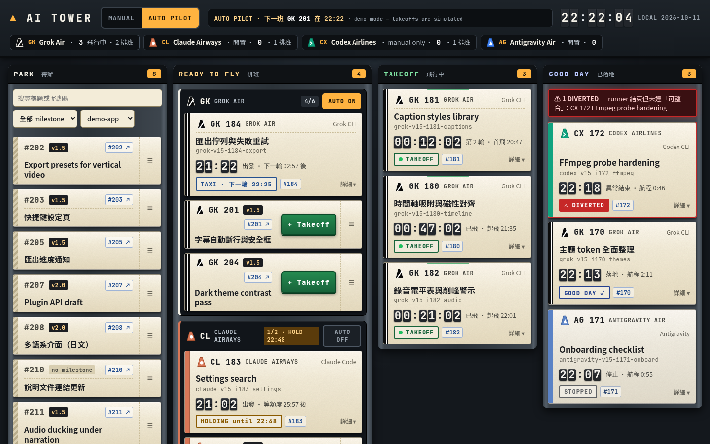

# AI Tower ✈

**A local control tower for background AI coding agents** — shows every agent job as a retro flight strip and lets you dispatch GitHub issues to agents (Grok CLI, Claude Code, Codex CLI, Antigravity) with one **Takeoff** button.

[繁體中文](#繁體中文) · [English](#english)



---

## English

### What it is
AI Tower is a tiny Node.js server (no dependencies) plus a single page. Every 10 s it reads, **read-only**:

- `ps` — runner scripts and agent processes (`grok -p`, `claude -p`, `agy -p`, `codex exec`, including stand-alone `codex exec`);
- runner logs — keyword lines `START / EXIT / LIMITCHECK / SLEEP / ROUND / DONE / STOP`;
- each worktree's progress file (`Status: …` line) and latest commit;
- open GitHub issues via `gh issue list` (cached 5 min).

Agents are shown as airlines — **GK Grok Air**, **CL Claude Airways**, **CX Codex Airlines**, **AG Antigravity Air** — with geometric tail-fin badges (no real logos).

| Bay | Meaning |
|---|---|
| **PARK** | open issues nobody is working on (search, milestone and repo filters). Issues that need a human on a real device (label or title start matching `manualIssueRegex`, default `manual\|實機`) go to a collapsible **🔧 needs a real device** section at the bottom: no drag handle, can't be queued or taken off, never picked by auto pilot |
| **READY TO FLY** | four airline lanes — drag issues in to queue them; runners between rounds (TAXI) or waiting for quota (HOLDING) also live here |
| **TAKEOFF** | agent process running now, live elapsed timer |
| **GOOD DAY** | finished (READY TO MERGE) · STOPPED (intentional, grey) · **DIVERTED** (abnormal exit, red, plus an alert row). **✕ 已知道** hides a card (5 s undo, kept in `data/dismissed.json`); every card auto-hides after `goodDayHideHours` (default 6) |

Flight number = airline code + the line's **primary issue** (first `#N` in its runner-table comment, else in its progress file); other issues show as blue tags.

### Dispatch
- Drag a PARK card (by its `≡` handle) into a lane; reorder within a lane; drag back to PARK to unqueue. 5 s undo. Keyboard: Space pick up · ↑↓ reorder · ←→ change lane · Space drop · Esc cancel.
- **✈ Takeoff** opens a confirm popover (agent, issue, branch, base). On confirm the server: fetches the issue (`gh issue view`), creates a worktree on a new branch `feat/<milestone>-<issue>-<slug>` from the first existing `baseBranches` entry, writes the prompt from your template, adds the line to the runner's case table (backup + `bash -n` first, atomic rename), and launches the runner detached. The card moves to TAKEOFF once the agent process is seen. Every takeoff is logged to `<logsDir>/tower-dispatch.log`.
- **MANUAL / AUTO PILOT** (header) plus a per-lane AUTO switch. Auto pilot departs the first card of each enabled lane when the airline has capacity (default GK 6, others 2, global 8) and is not holding for a usage limit. Only GK is AUTO ON by default; any lane can be locked to manual with `manualOnly`.
- **⚙ Model / effort** chip in every lane header: pick the model and reasoning effort from the lists each CLI reports (`grok models`, `claude --help`, `~/.codex/models_cache.json`, `agy models`). Saved to `<logsDir>/tower-models.env`; a per-flight override lives in the card's 詳細 (`tower-models.d/<line>.env`). The runner re-reads them at the start of every round, so changes apply to the **next round** and never interrupt a running agent. The first save installs a small hook in your runner (backup + `bash -n`); `examples/runner.example.sh` already has it.

### Install
Requirements: macOS or Linux, Node.js 18+, python3, git, [GitHub CLI](https://cli.github.com) (`gh auth login`).

```bash
git clone https://github.com/AndyJuang/ai-tower.git && cd ai-tower
./install.sh --demo        # demo data, nothing is launched → http://127.0.0.1:4777
./stop.sh
# real use: edit config.json (created by install.sh), copy the example runner, then
cp examples/runner.example.sh <logsDir>/runner.sh
./install.sh               # or ./start.sh / ./stop.sh
```

### Config (`config.json`, gitignored)
| key | meaning |
|---|---|
| `baseDir`, `logsDir` | where repos/worktrees and runner logs live (`~`, `{baseDir}` allowed) |
| `runnerScript` | runner file in `logsDir` with a `case "$A" in … *) …` table (see `examples/runner.example.sh`) |
| `logPattern`, `promptPattern`, `worktreePattern`, `mainCheckout` | file naming, `{line}` placeholder |
| `issueRepos`, `dispatchRepo`, `baseBranches` | PARK sources; primary repo and its base branch order |
| `products`, `primaryProduct` | repo → product `{name, short, color}`; every card and issue tag gets a badge (`MA #12`); flight numbers of non-primary products carry the code (`GK MD-12`) |
| `repos`, `promptTemplateOther`, `worktreeVar` | other repos can take off when they have a local clone (`repos[r].clone`, or auto-found as a git clone directly under `baseDir`); otherwise browse-only. Worktree `<clone>-wt-<line>`, base = `repos[r].baseBranches` or the origin default branch, prompt = `repos[r].promptTemplate` or `promptTemplateOther`. The runner gets a one-time `WTX` hook (backup + `bash -n`) so the case entry can point at that worktree; `worktreeVar` names the runner's worktree variable |
| `promptTemplate` | Markdown template with `{{issueTitle}}`, `{{issueBody}}`, `{{branch}}`, `{{pushRule}}`, `{{include:file}}` … |
| `lanes.XX.cap / auto / manualOnly / idleLabel`, `globalCap` | capacity and auto-pilot rules |
| `agentBins`, `modelCatalog` | optional CLI paths and a static model/effort list per lane (overrides discovery) |
| `manualIssueRegex`, `manualSectionTitle` | issues that need a real device (matched on labels and the start of the title) and the PARK section title |
| `goodDayHideHours`, `landedKeepMin` | GOOD DAY auto-hide (default 6 h) and when LANDED cards dim (30 min) |
| `doneRegex`, `stopByNames`, `tzLabel`, `cutoffHour`, `launchPrefix` | progress "done" marker, who counts as an intentional stop, clock label, runner cutoff hour, launch prefix (default `nice -n 10` [+ `caffeinate -i` on macOS]) |

Local state (`data/`: lane order, settings, issue cache, dispatched list) is gitignored. `titles.json` (optional) maps line/branch → friendly title.

### Security
- Binds **127.0.0.1 only**; requests with a non-loopback `Host` are refused (DNS-rebinding guard).
- Mutating endpoints (`/api/lanes`, `/api/settings`, `/api/preview`, `/api/takeoff`) need the **session token** embedded in the served page **and** a same-origin `Origin` header. The token is kept in `data/session-token` (gitignored, mode 600) so it survives restarts; an open page that hits a stale token re-reads it from `/api/token` (same-origin only) and retries once.
- Read-only towards running jobs: it never kills or edits a running runner; the runner file is only appended to (with backup) on Takeoff.
- Lanes start AUTO OFF except GK; `manualOnly` locks a lane to manual Takeoff. Background agents are told (prompt template) never to open GUI apps or browsers.
- No telemetry, no external calls except `gh` / `git` you already use.

### Limitations
- Process and log parsing assume the example runner's log format and `LC_ALL=C date` output.
- One dispatch repo at a time; other repos are browsable in PARK only.
- "Do not dispatch while I'm recording/presenting" is not implemented — use MANUAL mode.

---

## 繁體中文

### 這是什麼
AI Tower 是一個本機「塔台」：把背景跑的 AI 寫程式代理（Grok CLI、Claude Code、Codex CLI、Antigravity）用**復古航班條（flight strip）**呈現，並可把 GitHub issue 拖進各航空公司跑道、按 **✈ Takeoff** 直接派工。零相依的 Node.js 伺服器＋單一頁面，每 10 秒**唯讀**讀取 `ps`、runner 日誌、各 worktree 的進度檔與最新 commit，以及 `gh issue list`（快取 5 分鐘）。

四個航空公司：**GK Grok Air**、**CL Claude Airways**、**CX Codex Airlines**、**AG Antigravity Air**（幾何尾翼徽章，不使用任何真實商標）。

| 區 | 意義 |
|---|---|
| **PARK 待辦** | 還沒人做的 open issue（搜尋、milestone、repo 篩選）。需要實機測試的 issue（label 或標題開頭符合 `manualIssueRegex`，預設 `manual\|實機`）放在底部可收合的 **🔧 需要實機** 區：沒有拖曳把手、不能排班或起飛、Auto Pilot 不會選 |
| **READY TO FLY 排班** | 四條航空公司跑道；拖進來就排班。輪與輪之間（TAXI）或等額度（HOLDING）的 runner 也在這 |
| **TAKEOFF 飛行中** | agent 程序正在跑，即時計時 |
| **GOOD DAY 已落地** | 完成（READY TO MERGE／可整合）、STOPPED（刻意停止，灰）、**DIVERTED**（異常結束，紅＋警示列）。按 **✕ 已知道** 可隱藏（5 秒內可撤銷，記在 `data/dismissed.json`）；超過 `goodDayHideHours`（預設 6 小時）自動隱藏 |

航班號 = 航空公司代碼 + 該 line 的**主要 issue**（runner 對照表註解中的第一個 `#N`，沒有就看進度檔）；其他 issue 顯示為藍色標籤。

### 派工
- 抓 `≡` 把手把 PARK 卡拖進跑道；跑道內可調順序；拖回 PARK 取消排班；5 秒內可撤銷。鍵盤：空白鍵拿起、↑↓ 排序、←→ 換跑道、空白鍵放下、Esc 取消。
- 按 **✈ Takeoff** 會先跳確認（agent、issue、分支、base）。確認後：抓 issue 內容、從 `baseBranches` 第一個存在的分支開新 worktree 與分支 `feat/<milestone>-<issue>-<slug>`、依範本寫 prompt、把該 line 安全地加入 runner 的 case 表（先備份、`bash -n` 檢查、原子替換）、背景啟動 runner。看到 agent 程序後卡片移到 TAKEOFF。每次起飛都記錄在 `<logsDir>/tower-dispatch.log`。
- 上方 **MANUAL / AUTO PILOT** 總開關＋每條跑道 AUTO 開關。自動駕駛會在該航空公司有容量（預設 GK 6、其他 2、全域 8）且沒有因額度上限在等待時，讓跑道第一班起飛。預設只有 GK 開 AUTO；任何跑道都可用 `manualOnly` 鎖成只能手動。
- 每條跑道標頭的 **⚙ 模型 · effort**：從各 CLI 自己回報的清單選模型與推理強度（`grok models`、`claude --help`、`~/.codex/models_cache.json`、`agy models`）。存到 `<logsDir>/tower-models.env`；單一航班可在卡片「詳細」覆寫（`tower-models.d/<line>.env`）。runner 每一輪開始都會重讀，所以**下一輪生效**，不會中斷正在跑的 agent。第一次儲存會在 runner 加入讀設定的 hook（先備份＋`bash -n`）；`examples/runner.example.sh` 已內建。

### 安裝
需要 macOS 或 Linux、Node.js 18+、python3、git、[GitHub CLI](https://cli.github.com)（先 `gh auth login`）。

```bash
git clone https://github.com/AndyJuang/ai-tower.git && cd ai-tower
./install.sh --demo        # 示範資料，不會真的啟動任何東西 → http://127.0.0.1:4777
./stop.sh
# 正式使用：編輯 install.sh 產生的 config.json，複製範例 runner，然後
cp examples/runner.example.sh <logsDir>/runner.sh
./install.sh               # 或 ./start.sh / ./stop.sh
```

設定項目見上方英文表格；本機狀態（`data/`：跑道順序、設定、issue 快取、派工紀錄）與 `config.json` 都不進 git。

### 安全性
- 只綁 **127.0.0.1**；`Host` 不是本機的請求一律拒絕（防 DNS rebinding）。
- 會改動狀態的 API 需要頁面內嵌的 **session token**，且 `Origin` 必須同源。token 存在 `data/session-token`（不進 git、權限 600），重啟後不變；已開著的頁面若遇到舊 token，會自動向 `/api/token`（限同源）重新取得並重試一次。
- 對執行中的工作唯讀：不會砍或修改正在跑的 runner；只有 Takeoff 會在備份後新增 runner 條目。
- 預設只有 GK 開 AUTO；`manualOnly` 可把跑道鎖成只能手動；prompt 範本要求背景代理不得開任何 GUI 或瀏覽器。
- 沒有遙測；除了你本來就在用的 `gh`／`git` 之外不連外。

### 限制
- 日誌解析依賴範例 runner 的格式與 `LC_ALL=C date` 輸出。
- 一次只派工到一個 repo；其他 repo 只能在 PARK 瀏覽。
- 「錄影／簡報中不要派工」尚未實作——請用 MANUAL 模式。

## License
[MIT](LICENSE)

Screenshots use the built-in demo data (`./install.sh --demo`).
